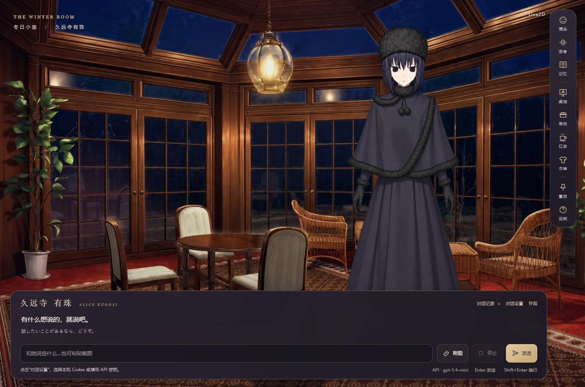

# 有珠 · 冬日小室

Windows x64 小室与透明桌宠，同人私人定制版本 **1.0.0**。基于 Electron 与现有 Live2D 模型，不依赖 LingChat。



面向 Windows 10/11 的 Intel/AMD 64 位电脑，需显卡驱动支持 WebGL2。Windows 7/8/8.1、32 位系统不在本包支持范围；ARM 的模拟运行尚未验证。无需为显示角色额外安装 Node.js 或 Python，内置语音可离线使用。

## 使用发布版

在 Releases 下载单文件 EXE，或下载便携 ZIP 并解压后运行其中的 AliceKuonji.exe。无需 Node.js、Python 或 Live2D 编辑器。详情见 [使用说明](apps/alice-desktop/release-docs/使用说明.txt)。

## 功能

- 小室 / 透明桌宠、三套衣装、20 种差分表情与预览。
- 抚摸举书、Robin 来访、寿司投喂、红茶品质与泡茶。
- 侧边隐藏、定时偷看、临时企鹅装、连续大小与透明度。
- 对话与附图、头顶双语字幕、可选语音、话后表情包。
- 独立记忆、存档、可选主动交流、Robin 飞行启动画面。

对话需要用户自己的 API 或已登录的本机 Codex。内置音频可离线播放；自由合成语音需要另行配置的 GPT-SoVITS 本机环境，本仓库不含其权重、训练数据和 Python 环境。

## 从源码运行

使用 Node.js 22.12 或更新版本，在仓库目录运行：

```powershell
npm ci
npm start
npm test
```

已提交运行所需的角色、美术、内置音频和 Core；资源无需从训练目录重新生成。单独重做表情定义可运行 `node apps/alice-desktop/prepare-expressions.cjs`。

## 打包

在 Windows x64 安装 7-Zip 和系统 .NET Framework C# 编译器后运行 `npm run package`。默认寻找标准安装位置，可用 SEVEN_ZIP 和 CSC_PATH 指定工具。输出在 release/v1.0.0/；已有目录时拒绝覆盖。包内含 Electron/Chromium 许可、第三方说明、单文件 EXE、便携 ZIP 和 SHA-256。

正式用户配置独立于仓库，继续保存在应用数据目录 AliceKuonjiWinter/2.4。源码预览配置不自动导入。

## 验收与来源

发布检查摘要见 [验证记录](docs/VALIDATION.md)。改动记录见 [RELEASE-NOTES](apps/alice-desktop/release-docs/RELEASE-NOTES.md)。

[素材与第三方说明](apps/alice-desktop/release-docs/THIRD-PARTY-NOTICES.md)：非官方同人项目，第三方素材适用各自条件；人设改写文本另见所附 CC BY-NC-SA 4.0 说明。当前仓库为私人保存用途，未将所有混合素材声明为统一开源许可。
