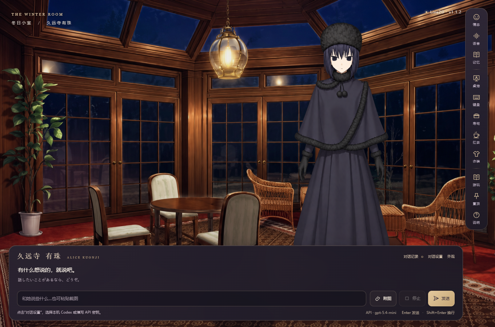

# 有珠 · 冬日小室

陪久远寺有珠泡一杯红茶，或者让她把书带到你的桌面。Windows 10/11 x64 Live2D 同人桌宠，当前版本 **1.1.2**。



## 下载安装

在 [GitHub Releases](https://github.com/futabaovo/alice-winter-room/releases) 下载 Windows x64 单文件 EXE，或解压便携 ZIP 后运行其中的 AliceKuonji.exe。运行发行版需要支持 WebGL2 的显卡驱动，无需另装 Node.js、Python 或 Live2D 编辑器。

升级前请关闭正在运行的旧版。正式版沿用应用数据目录 AliceKuonjiWinter/2.4。详情见 [使用说明](apps/alice-desktop/release-docs/使用说明.txt)。

## 功能

- 冬日小室与透明桌宠，支持立绘、Q 版、三套衣装和 20 种表情。
- 抚摸举书、侧边偷看、Robin 来访、寿司投喂与泡茶互动。
- 书本保卫战与像素键盘模式，提供视线跟随和快捷键动作。
- 对话与附图、双语字幕、口型同步、记忆和存档。

内置台词可离线播放。对话使用自己的 API 或已登录的本机 Codex。1.1.2 支持使用已配置的本地有珠声线，也能用 Windows 系统语音朗读。训练声线的推理环境和权重需要另行配置。

## 从源码运行

使用 Node.js 22.12 或更新版本，在仓库目录运行：

```powershell
npm ci
npm start
npm test
```

打包使用 Windows x64、7-Zip 和系统 .NET Framework C# 编译器。运行 `npm run package`，文件输出至 `release/v1.1.2/`。可通过 `SEVEN_ZIP` 与 `CSC_PATH` 指定工具路径。

## 验证与素材

- [版本更新记录](apps/alice-desktop/release-docs/RELEASE-NOTES.md)
- [验证记录](docs/VALIDATION.md)
- [素材与第三方说明](apps/alice-desktop/release-docs/THIRD-PARTY-NOTICES.md)

本项目为非官方同人应用，相关角色和素材保留各自的使用条件。
